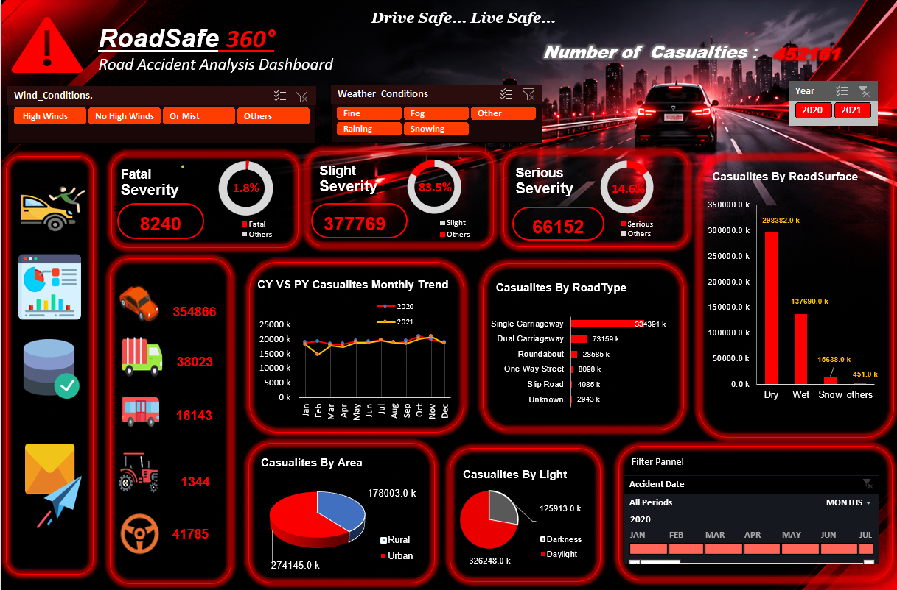

# 🚦 RoadSafe 360° – Road Accident Analysis Dashboard

## Project Overview

RoadSafe 360° is an interactive Microsoft Excel-based Data Analytics project developed to analyze road accident casualties and understand accident patterns. The project focuses on identifying accident severity, vehicle involvement, road conditions, weather conditions, lighting conditions, geographical distribution, and accident trends to support data-driven road safety analysis.

## Project Objectives

- Analyze total road accident casualties.
- Identify fatal, serious, and slight accident severity.
- Compare casualties across different years.
- Analyze monthly casualty trends.
- Identify casualty patterns across different road types and surface conditions.
- Understand casualty distribution under different weather and lighting conditions.
- Compare casualties in urban and rural areas.
- Analyze casualties by vehicle type.
- Generate meaningful insights from accident data.

## Project Scope

- **Total Records:** 333,554
- **Analysis Period:** 2020–2021
- **Total Casualties:** 452,161
- **Dataset Columns:** 14
- **Geographical Analysis:** District-level accident data

## Tools & Technologies

- Microsoft Excel
- Excel Tables
- Data Cleaning
- PivotTables
- PivotCharts
- Excel Slicers
- Excel Timeline
- KPI Analysis
- Data Visualization

## Dataset Description

The dataset contains road accident information with the following fields:

1. Accident Severity
2. Accident Date
3. Year
4. Light Conditions
5. District Area
6. Number of Casualties
7. Number of Vehicles
8. Road Surface Conditions
9. Road Type
10. Urban or Rural Area
11. Weather Conditions
12. Wind Conditions
13. Vehicle Type
14. Additional Weather Conditions field

## Data Cleaning & Preparation

The dataset was reviewed and prepared in Microsoft Excel for further analysis.

Key activities:

- Reviewed dataset columns and records.
- Organized accident date and year fields.
- Reviewed categorical values.
- Prepared the cleaned dataset for PivotTable analysis.
- Organized data for dashboard reporting.

## Excel Analysis Techniques

- **Data Cleaning:** Preparing and organizing accident records.
- **PivotTables:** Summarizing casualties across different categories.
- **PivotCharts:** Visualizing accident analysis results.
- **KPI Analysis:** Displaying total, fatal, serious, and slight casualties.
- **Slicers:** Filtering dashboard data interactively.
- **Timeline:** Analyzing accident casualties across selected date periods.
- **Comparative Analysis:** Comparing monthly casualties between 2020 and 2021.
- **Percentage Analysis:** Understanding the distribution of casualties across categories.

## Dashboard Features

### 1. Primary KPIs

- Total Casualties
- Fatal Casualties
- Serious Casualties
- Slight Casualties

### 2. Secondary Analysis

- Casualties by Vehicle Type
- Casualties by Road Type
- Casualties by Road Surface
- Casualties by Urban and Rural Areas
- Casualties by Light Conditions
- Casualties by Weather Conditions
- Casualties by Wind Conditions

### 3. Trend Analysis

- Current Year vs Previous Year Monthly Casualty Comparison.
- Monthly casualty trends from January to December.
- Year-wise casualty comparison.

### 4. Interactive Filters

- Year Filter
- Weather Conditions Filter
- Wind Conditions Filter
- Accident Date Timeline

These filters allow users to explore accident casualty data based on selected conditions and time periods.

## Dashboard Preview

### Main Dashboard

### Cleaned Dataset

### PivotTable Analysis

## Key Performance Indicators (KPIs)

| KPI | Total Casualties |
|---|---:|
| Total Casualties | 452,161 |
| Fatal Casualties | 8,240 |
| Serious Casualties | 66,152 |
| Slight Casualties | 377,769 |

### Severity Distribution

- **Fatal:** 1.82%
- **Serious:** 14.63%
- **Slight:** 83.55%

## Key Analytical Insights

Based on the Excel PivotTable analysis:

1. **Accident Severity:** Slight casualties account for 83.55% of total casualties, followed by serious casualties at 14.63% and fatal casualties at 1.82%.

2. **Vehicle Type:** Cars account for 354,866 casualties (78.48%), representing the largest vehicle category.

3. **Road Type:** Single Carriageways account for 334,391 casualties (approximately 73.95%).

4. **Road Surface:** Dry road surfaces account for 298,382 casualties, while wet surfaces account for 137,690 casualties.

5. **Lighting Conditions:** Daylight accounts for 326,248 casualties, compared with 125,913 in darkness.

6. **Geographical Analysis:** Urban areas record 274,145 casualties, compared with 178,003 in rural areas.

These findings highlight casualty distribution across different road, vehicle, environmental, and geographical categories.

## Recommendations

Based on the dashboard analysis, the following areas deserve further investigation:

- **Single Carriageways:** Prioritize road safety assessments on single carriageways.
- **Urban Road Safety:** Investigate traffic management and pedestrian safety in urban areas.
- **Vehicle Safety:** Promote car safety awareness and responsible driving practices.
- **Wet Road Conditions:** Encourage safe driving practices during rainy conditions.
- **Night-Time Safety:** Improve road visibility and lighting awareness.
- **Monthly Monitoring:** Track monthly casualty trends to identify periods requiring additional road safety attention.

## Project Workflow

1. **Data Collection:** Obtained the road accident dataset.
2. **Data Cleaning:** Prepared and organized accident records in Excel.
3. **Data Analysis:** Created PivotTables to summarize casualty information.
4. **Data Visualization:** Developed PivotCharts for different accident categories.
5. **Dashboard Development:** Designed the RoadSafe 360° dashboard.
6. **Interactivity:** Added Slicers and Timeline for dynamic filtering.
7. **Insight Generation:** Analyzed results and identified important casualty patterns.

## Project Structure    
excel project analysis/
│
├── README.md
│
├── Dataset/
│   └── DataSet_accident_data.zip
│
├── Excel_Project/
│   ├── Cleaned_Excel_Data.xlsx
│   ├── Pivot_Tables.xlsx
│   └── Road_Accident_Analysis.xlsx
│
└── Dashboard/
    └── Main_Dashboard.png

## Project Highlights

- Analysis of 333,554 accident records.
- Interactive Excel dashboard with multiple filters.
- Year-wise and monthly casualty trend comparison.
- KPI-based casualty severity analysis.
- Vehicle type and road condition analysis.
- Weather and lighting condition analysis.
- Interactive data visualization.
- Data-driven road safety insights.

## Author

**Shreya Mahajan**

Aspiring Data Analyst

**Tools:** Microsoft Excel | Data Analysis | Data Visualization
